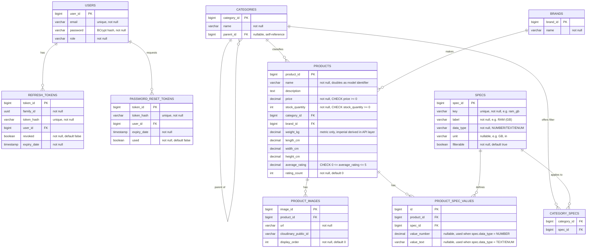

# Entity Relationship Diagram — Project 1 (Foundation)

Scope: auth domain (users, refresh tokens, password reset tokens) and catalog domain
(products, categories, brands, product images, filterable specs). Project 2/3 entities
(cart, order, customer) are intentionally excluded. CAPTCHA, OAuth, and 2FA need no
tables of their own at this stage — see "Excluded" below.

Catalog scope: Technix, an electronics retailer selling Laptops and Phones (2 top-level
categories). Category-specific filterable specs (RAM, GPU, CPU, display size) use a
typed EAV model so new specs can be added later without schema changes.

## Diagram



## Relationships — cardinality and modality

| Relationship | Cardinality | Modality |
|---|---|---|
| User → RefreshToken | 1 user : 0..N tokens | Mandatory on token side (a token always has a user); in practice 1..N on the user side since `register()`/`login()` issue one immediately |
| User → PasswordResetToken | 1 user : 0..N tokens | Mandatory on token side; optional on user side (most users never request a reset) |
| Category → Category (self-ref) | 1 parent : 0..N children | Optional — root categories have `parent_id = null` |
| Category → Product | 1 category : 0..N products | Mandatory on product side; optional on category side (a category can exist with zero products) |
| Brand → Product | 1 brand : 0..N products | Same shape as Category → Product |
| Product → ProductImage | 1 product : 0..N images | Mandatory on image side; optional on product side at the DB level (Postgres can't enforce "≥1 child row" without a trigger) |
| Category ↔ Spec (via CategorySpecs) | M categories : N specs | Optional both sides — a spec may apply to multiple categories (e.g. `ram_gb`, `display_size_in` apply to both Phones and Laptops); a category may have zero specs if none are configured yet |
| Product → ProductSpecValue | 1 product : 0..N values | Mandatory on value side; optional on product side (a product may not have a value for every spec) |
| Spec → ProductSpecValue | 1 spec : 0..N values | Mandatory on value side; optional on spec side (a spec may not yet be used by any product) |

Note on shared specs: `price` and specs like `display_size_in` are single, category-agnostic
columns/rows — the numeric range naturally differs per category (phones ~5-7in, laptops
~13-17in) without needing separate definitions per category. What scopes results to one
category is the `category_id` filter applied alongside the spec filter, not separate storage.
This matches how real faceted-search systems (e.g. Magento's EAV-based layered navigation)
handle it.

## Indexes (beyond PK/unique, for faceted search and sort performance)

- `products(category_id)`, `products(brand_id)` — facet filters
- `products(price)`, `products(average_rating)` — range filter and sort
- `products(name)` — GIN/trigram (`pg_trgm`) index for search suggestions
- `categories(parent_id)` — hierarchy traversal
- `refresh_tokens(family_id)` — required by the bulk `revokeAllByFamilyId` update
- `product_spec_values(spec_id, value_number)` — numeric spec range filters (RAM, display size)
- `product_spec_values(spec_id, value_text)` — text/enum spec filters (CPU, GPU)

## Excluded from this schema

- **CAPTCHA** — stateless, verified server-side per request, no persistence needed.
- **OAuth** — would need an `oauth_identities` table (provider + external id → user); out of scope for now.
- **2FA** — would need a `totp_secret` column on `users`; out of scope for now.
- **Customer / Order / ShoppingCart** — Project 2/3 scope.

## DBML (for dbdiagram.io)

```dbml
Table users {
  user_id bigint [pk, increment]
  email varchar [unique, not null]
  password varchar [not null]
  role varchar [not null]
}

Table refresh_tokens {
  token_id bigint [pk, increment]
  family_id uuid [not null]
  token_hash varchar [unique, not null]
  user_id bigint [not null]
  revoked boolean [not null, default: false]
  expiry_date timestamp [not null]

  indexes {
    family_id
  }
}

Table password_reset_tokens {
  token_id bigint [pk, increment]
  token_hash varchar [unique, not null]
  user_id bigint [not null]
  expiry_date timestamp [not null]
  used boolean [not null, default: false]
}

Table categories {
  category_id bigint [pk, increment]
  name varchar [not null]
  parent_id bigint [null]

  indexes {
    parent_id
  }
}

Table brands {
  brand_id bigint [pk, increment]
  name varchar [not null]
}

Table products {
  product_id bigint [pk, increment]
  name varchar [not null, note: 'doubles as model identifier']
  description text
  price decimal(10,2) [not null, note: 'CHECK price >= 0']
  stock_quantity int [not null, note: 'CHECK stock_quantity >= 0']
  category_id bigint [not null]
  brand_id bigint [not null]
  weight_kg decimal(8,3) [null, note: 'metric stored; imperial derived in API layer']
  length_cm decimal(8,2) [null]
  width_cm decimal(8,2) [null]
  height_cm decimal(8,2) [null]
  average_rating decimal(3,2) [null, note: 'CHECK 0 <= average_rating <= 5']
  rating_count int [not null, default: 0]

  indexes {
    category_id
    brand_id
    price
    average_rating
    name [type: gin, note: 'pg_trgm, for search suggestions']
  }
}

Table product_images {
  image_id bigint [pk, increment]
  product_id bigint [not null]
  url varchar [not null]
  cloudinary_public_id varchar [null]
  display_order int [not null, default: 0]
}

Table specs {
  spec_id bigint [pk, increment]
  key varchar [unique, not null, note: 'e.g. ram_gb']
  label varchar [not null, note: 'e.g. RAM (GB)']
  data_type varchar [not null, note: 'NUMBER / TEXT / ENUM']
  unit varchar [null, note: 'e.g. GB, in']
  filterable boolean [not null, default: true]
}

Table category_specs {
  category_id bigint [not null]
  spec_id bigint [not null]

  indexes {
    (category_id, spec_id) [pk]
  }
}

Table product_spec_values {
  id bigint [pk, increment]
  product_id bigint [not null]
  spec_id bigint [not null]
  value_number decimal(12,2) [null, note: 'used when spec.data_type = NUMBER']
  value_text varchar [null, note: 'used when spec.data_type = TEXT/ENUM']

  indexes {
    (product_id, spec_id) [unique]
    (spec_id, value_number)
    (spec_id, value_text)
  }
}

Ref: refresh_tokens.user_id > users.user_id [delete: cascade]
Ref: password_reset_tokens.user_id > users.user_id [delete: cascade]
Ref: categories.parent_id > categories.category_id [delete: restrict]
Ref: products.category_id > categories.category_id [delete: restrict]
Ref: products.brand_id > brands.brand_id [delete: restrict]
Ref: product_images.product_id > products.product_id [delete: cascade]
Ref: category_specs.category_id > categories.category_id [delete: cascade]
Ref: category_specs.spec_id > specs.spec_id [delete: cascade]
Ref: product_spec_values.product_id > products.product_id [delete: cascade]
Ref: product_spec_values.spec_id > specs.spec_id [delete: cascade]
```
